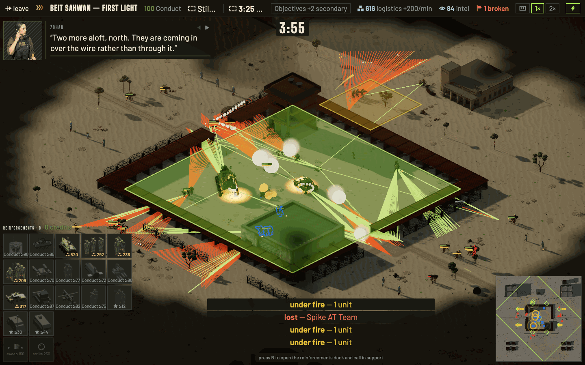
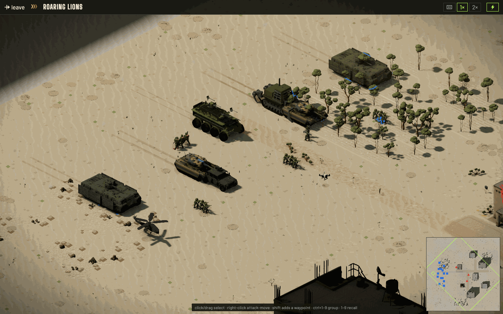

# Roaring Lions

A real-time strategy game in the Command & Conquer tradition, played in your browser. You command the 401st "Ari'im" Brigade of the Kedem Defense Forces (KDF) through a campaign across the fictional Sahar Basin, or take the field against a friend or a basic computer opponent. It is inspired by modern Middle East conflicts; every place, faction and person in it is fictional.

Its distinguishing claim is that combat **simulates real engagement odds** instead of trading hit points. A shot has to be seen, has to hit, has to get through the armour, and then damages a component. Cover and suppression decide fights more than raw damage does. Information, initiative and restraint are the scarce things: every mission scores your **Conduct**, and civilian harm, ruined protected buildings and wasteful ordnance cost you.

Enemy forces are defined by military doctrine (tunnels and ambush, standoff fires, mobile raiding), never by ethnicity, nationality or faith.



## Play it

**<https://roaring-lions.pint12.workers.dev>**

You need a desktop browser with WebGL2, and a mouse and keyboard. There is nothing to install, and no account is needed to play. That address serves the current `main`. Source and issues: <https://github.com/ilan-pinto/roaring-lions>.

On first launch an opening cinematic plays. Skip it at any time; Settings can replay it.

### The main menu

| Entry | What it is |
|---|---|
| **Start** / **Continue** | Jumps to the next mission of the campaign (the tutorial first). |
| **Campaign** | The campaign map: three fronts, 38 missions. |
| **Brigade** | The garage and the Stores: your units, their upgrades, what unlocks what. |
| **Play with a friend** | Open or join a one-versus-one room, or play a basic computer opponent. |
| **free play, any map** | Walk any listed map with a full task force, no mission needed. |
| **replay the tutorial** | *Working Up*, a guided first mission. |
| Saves, Settings, Credits, Privacy, Feedback | Save slots, options, credits, the privacy page and the feedback form. |
| **Sign in** / **Sign up** | Optional account (see [The brigade](#the-brigade-credits-and-roar-coins)). |
| **New campaign** | Starts the campaign over. Your brigade (credits, unlocks, upgrades) stays. |

A mission you left with **Save and quit** (pause menu) shows a *Resume* card on the menu: it picks the mission up where you left it. See [Save and resume](#save-and-resume).

## How to play

The camera looks down at an angle. Select units, give orders, read the ground.

| To do this | Do this |
|---|---|
| Select | Left-drag a box, or click a unit. Click empty ground to clear. |
| Attack-move | Right-click ground. Units engage what they meet on the way. `Shift` queues the order behind the current one. |
| Plain move | Press `n`, then click the ground. |
| Patrol | Press `p`, then click the far end (`Shift`-click adds points). |
| Garrison or demolish | Right-click a building. Troops that can enter it garrison it; Combat Engineers and the D9 raze it. A protected building (a civic hall, say) refuses fire unless you hold `Alt`. |
| Attack one target | Right-click a visible enemy. |
| Formations | With two or more units selected: `r` Column (march in two files), `t` Attack (armour leads, infantry close behind), `y` Ambush (ring the ground and hold). Then click the ground. |
| Control groups | `Ctrl` (`Cmd` on a Mac) + `1`-`9` assigns, `1`-`9` recalls, a second tap centres the camera. |
| Halt | `h` |
| Smoke | `f` lays smoke at the cursor. |
| Load and unload | `g` loads infantry into a carrier, `u` unloads. |
| Idle units, last alert | `i` selects the next idle unit; `Space` jumps to the latest alert. |
| Production dock | `b`. Buy reinforcements with logistics. |
| Fire support | `z` smoke screen, `q` mortar barrage, `c` drone sweep, `v` precision strike. These spend intel. |
| Camera | `W` `A` `S` `D` or the arrows to pan, the wheel to zoom. The minimap takes right-click orders too. |
| Every key | `F1`. `Esc` backs out of whatever is open, and otherwise pauses. |

Two things worth knowing early:

- **Hover a visible enemy with units selected** and the *Projected fire* panel shows each unit's chance to hit, and what is degrading it, before you commit.
- **Cover is the big lever.** A dug-in target is both harder to hit and harder to pin. Armour is thin at the rear: keep its nose to the enemy.

Every binding except `Tab`, `Esc`, the control-group digits and the arrow keys can be rebound under Settings, Controls.

## The campaign

You play a KDF officer, Shai Hammai, from a dawn siege to the end of the war, with Idit Zohar, the intelligence officer, supplying the intel. Briefings come in beats on the deploy screen; radio lines and objective labels carry the story during a mission.

| Front | Enemy doctrine | Towns (missions) |
|---|---|---|
| **The Marj Strip** | Ashwar Front: tunnels, IEDs, ambush, human terrain | Beit Sahwan (5), Qasr Liwan (5), Khan Rafid (3), Deir Amun (3), Bir Tarsha (4) |
| **Sur** | Sarim Brigades: rockets, anti-tank missiles, standoff | Tel Marum (3), Qarn Hadid (3), Umm Zeitoun (4) |
| **Naharin** | Rif Cells: technicals, raids, mobility; wet ground and rain | Wadi Halam (5), Ein Qasab (3) |

The war opens with *First Light* in Beit Sahwan. Bir Tarsha opens after Deir Amun III, Sur after Bir Tarsha V, Naharin after Umm Zeitoun IV, and Ein Qasab after Wadi Halam III. Each mission is meant to take five to seven minutes and has a time limit; running out with a primary objective open is a defeat. The tutorial, *Working Up*, is the thirty-ninth mission file and sits outside the map.

- **Deploy.** Before a mission you pick which veterans fill its slots. Units keep a service record, and veterans aim better and resist suppression.
- **Objectives.** Locate, hold for a time, survive until relief, capture, eliminate a target, evacuate civilians, collapse a tunnel, raze a building, or destroy everything.
- **Held ground pays.** Eighteen missions (in Beit Sahwan, Bir Tarsha, Qasr Liwan, Deir Amun, Ein Qasab, Khan Rafid, Qarn Hadid, Tel Marum, Umm Zeitoun and Wadi Halam) have income zones: ground you hold alone pays logistics each minute, and an enemy inside pays nobody.
- **Conduct and stars.** Every mission scores Conduct from 0 to 100. A win earns one star; a second for Conduct above the mission's floor; a third for completing every secondary objective that counts toward it (only secondaries flagged as carrying do), so a mission with none tops out at two stars. The debrief lists each Conduct deduction by reason, your losses by name, and the credit payout.
- **Why a unit died.** The debrief says how each named loss fell (penetrated through the rear by a named gun, shot, burned down, struck by a kamikaze), and the card of the unit that takes its slot repeats it. When the events cannot say how, it names only who, not a guess.
- **Wounded men.** An infantryman who falls may go down wounded instead of dying. He bleeds out unless a medic reaches him, and nobody fires on him. Most missions loan you a Nemala Medic Team, and rescuing a wounded man, enemy or civilian, earns Conduct.
- **Intel and the ledger.** Recon in one mission can change the next. The ledger carries your named units, Conduct, stars, intel, evacuated civilians and recovered hostages from mission to mission.
- **Difficulty.** Choose Easier, Standard or Harder on the campaign board, and again on the deploy screen. Easier thins the enemy's waves and sends a relief squad at a minute and a half, but caps a mission at two stars and pays no carry credits; Harder thickens the waves. Standard is the default, and the tutorial has no choice.

### Save and resume

**Save and quit** in the pause menu saves the mission in progress, and the menu then offers to resume it. There is one such save. Saving another mission asks before it replaces it, and a save refuses to resume if your brigade has changed since, or if it was made on an older version of the game (the card says which). Separately, **Saves** keeps whole-campaign slots you can export and import.

## Units



### KDF (the player's brigade)

Your brigade starts with the five units marked *start*. The rest open on **Conduct** (your campaign average, with floors from 70 to 90), on **total stars**, or can be bought with **credits**. Earning is always free; credits only get you there sooner. Most units also have three upgrade tracks (armour, sensors, firepower). The Rifle Squad and the Combat Engineers carry the newest, Meshy-based figures.

| Unit | Role | What it is for | Opens |
|---|---|---|---|
| Rifle Squad | Infantry | Holds ground and garrisons buildings. Its rifles are the safest thing to fire in a street. | start |
| Chomet Grenadier Squad | Infantry | Grenades reach men behind a wall, never inside a house. Costs Conduct in a flagged street. | credits |
| Spike AT Team | Anti-tank | Kills armour rifles cannot touch, one missile at a time. | start |
| Zaron Missile Team | Anti-tank | Kills what your side has spotted, without a sight line. Useless up close. | credits |
| Sniper Team | Marksman | One man at a time, at the least cost a shot can carry. | Conduct 80 |
| 60mm Mortar Team | Artillery | Fires past its own sight, so someone else must look. | start |
| Te'o Howitzer, Te'o Cluster Howitzer | Artillery | The deepest gun on the map, and bomblets for men in the open. | credits |
| Lavi MBT | Tank | Wins any duel it can see out to twelve tiles. Its 120mm is the costliest round for Conduct. | Conduct 90 |
| Lavi Ambush Tank | Tank | Waits under a net and is seen late. A shot gives it away. | credits |
| Namer IFV | Infantry fighting vehicle | Carries five under armour; its 30mm arms the protected-zone penalty. | Conduct 85 |
| Eitan APC | Carrier | Armour that keeps up with the tanks, seats for two, and a gun that answers aircraft. | start |
| Kipod Screen Carrier | Carrier | Six seats behind reactive plate, and a gun that pins people without killing a truck. | 44 stars |
| Shoded Jeep | Light vehicle | Fast and thin. Two seats, a machine gun, nothing that stops a rocket. | start |
| Shachaf Scout Car | Recon | A ground eye that sees sixteen tiles from its mast. Lightly armed: one cupola machine gun, 6 tiles. | 30 stars |
| Recon Drone | Drone | Sees sixteen tiles and marks what it finds. No weapon. | Conduct 70 |
| Loitering Munition | Drone | Flies itself at the nearest thing your side has identified, and does not come back. | Conduct 72 |
| Chadaf Recon Robot | Drone | Walks boulders and alleys no wheel can, and finds tunnel routes. Unarmed. | credits |
| AH-64 Peten, Peten Gunship | Gunship | Crosses the map in seconds and kills armour at standoff. | Conduct 82, credits |
| UH-60 Yanshuf | Air transport | Six squads anywhere on the map in a minute. Lose it in the air and you lose them all. | Conduct 84 |
| Remetz Laser Carrier | Anti-air | A laser that burns small drones out of the air, and goes dark behind smoke or a wall. | Conduct 85 |
| Combat Engineers | Engineer | Bring a building down from touching distance without shelling the street. | Conduct 77 |
| D9 Dov | Engineer | Takes a building down with a blade instead of a shell. Unarmed. | Conduct 87 |
| Shiryonan Demolition Carrier | Engineer | Sets a fused charge against a wall and backs off. | credits |
| Yahalom Engineers | Engineer | The only team that can collapse a tunnel. | Conduct 75 |
| Tzinah Breach Team | Support | Empties a garrisoned house instead of levelling it. | 12 stars |
| Shmamit Deep Recon Team | Support | Keeps a tunnel in sight from boulders or a house, unseen. | credits |
| Nemala Medic Team | Support | Treats wounded men under fire and stretchers them out. | credits |
| Pered Armoured Ambulance, Nachlieli Medevac | Support | Carry four wounded out of the fight, by road or by air. Unarmed. | credits |

### The other side

You meet these in the campaign, one doctrine per front: the **Ashwar** on the Marj Strip (militia cells, RPG teams, mortar crews, diggers, suicide squads, powered parachutes), the **Sarim** on Sur (rifles, Kornet ATGM cells, recoilless teams, MANPAD teams, Grad rocket batteries, loitering munitions and drone swarms) and the **Rif** on Naharin (armed technicals and motorcycles, AA gun trucks). In a [KDF-against-Sarim match](#play-with-a-friend-or-the-computer) the Sarim player builds six of them (listed below). Free play can add four more Sarim units with its *Sarim roster* option.

## The brigade, credits and Roar coins

Campaign wins pay **credits**: 100 for the win, 40 per carrying secondary objective, 10 per starting-force unit brought home, and 1 per Conduct point over the second-star floor. A replay pays only the improvement, and a defeat pays nothing. The tutorial pays nothing. **Credits are earned and never sold.**

Spend credits in the **garage** (Brigade on the menu): unlock a unit you have not yet earned, or upgrade it. Most units have three tracks, **armour**, **sensors** and **firepower**, each with up to three tiers, and a bought tier applies to every unit of that type. The Rifle Squad's armour tiers cost 115, 175 and 250 credits. Turn each model in a close-up and read its specification before buying.

**Roar coins** are the second currency, and today they are free. Every player has a coin wallet that survives *New campaign*; coins are earned in the campaign (100 on the first victory, 10 for the first win of each mission, 5 per new star, 100 for finishing the campaign) and the Stores can spend them, at 1 coin = 10 credits, on the same units and upgrade tiers credits buy. **Honestly, what the build does today:** no money moves anywhere (the real-money coin packs are switched off), and the Stores has no cosmetics yet. The project's rule (the lead, 18 Nov 2026) is that **coins buy new units**, and the Stores sell upgrade tiers for coins too: that is what the build does today, with the coins you earn. Brigade credits are earned and never sold.

An optional **account** (Sign in / Sign up on the menu) keeps your campaign, brigade and coins on a server instead of in one browser, and shows your coin balance and its history on the profile page. It is on in the live build when the host has opened sign-in; without an account everything stays in your browser, and the brigade survives **New campaign** either way.

## Free play

Free play (menu, *free play, any map*) puts a full KDF task force (or, with the side pick, a Sarim one) on any of the 48 listed maps against an opposing force, with no mission, and writes nothing to your campaign. It is the place to try a unit, learn a map, or test a tactic. Optional extras:

| Option | Adds |
|---|---|
| Protected ground | No-fire ground that costs Conduct to fire on. |
| Tunnel | A dug tunnel and two Yahalom squads to collapse it. |
| Sarim roster | Four Sarim units the campaign never fields. |
| Civilians | Eight civilians and a refuge to lead them to. |
| Anti-tank ditch | A ditch between the two forces. |
| Kit | Your force already fitted with upgrade level 1 to 3. |
| Field works | Buildable field works and an engineer squad to raise them. |
| Decals, Rubble, Ragdolls, Soft smoke | Ground marks, collapsed buildings, falling squads and softer smoke, on show. |

## Play with a friend, or the computer

A one-versus-one match over the internet. Both browsers run the same deterministic simulation and only orders cross the wire. It is for friends: there is no matchmaking and no ranking. Nothing from a match is written to your campaign or brigade.

1. The host opens the menu, **Play with a friend**, enters a callsign, and picks a side and a map (below).
2. The host presses **Open a room** and sends the friend the six-character code, or **Copy link**.
3. The friend opens the link (or types the code into *Room code* under *Got a code from a friend?* and presses *Join*), enters a callsign, and joins.
4. Both press **Ready**. The match starts for both.

Both of you need the same version of the game: reload the page if the room reports a mismatch.

**Play a basic computer opponent** is the same screen without a friend. It needs no room: the match runs on this device. The opponent attacks with the force it starts with and builds nothing, so it is a place to learn a map, not a test of skill.

**Choose your side.**

| Side | What you get |
|---|---|
| **Mirror** | KDF against KDF. Both of you field the same placed force of tanks, IFVs, infantry, a gunship and a recon drone. Nothing is built or bought. |
| **KDF** | You command the KDF; your friend takes the Sarim. |
| **Sarim** | You command the Sarim: anti-tank teams by the dozen, gun trucks and Grad rockets. |

**Choose the ground and how it is won.** Every match can be won by annihilation (destroy every enemy combat unit). A map also offers the other win modes that were measured fair on it, and only those:

| Map | Size | KDF against Sarim | Mirror win modes besides annihilation |
|---|---|---|---|
| Tel Marum, The Gateway | 48 x 48 | yes | Points race |
| Wadi Tarfan, The Three Fords | 48 x 48 | yes | Destroy the camp, Points race, Capture the flag |
| Wadi Tarfan (large) | 96 x 96 | yes | Destroy the camp, Points race, Capture the flag |
| Beit Sahwan, Outskirts | 48 x 48 | no | Points race |
| Milh Flats, Bir Milh | 48 x 48 | no | Destroy the camp, Points race |
| Milh Flats (large) | 96 x 96 | no | Points race, Capture the flag |
| Rujm Sawda, The Black Cairn | 80 x 80 | no | Points race, Capture the flag |

In a KDF-against-Sarim room only annihilation is offered, except *Destroy the camp*, which both Wadi Tarfan maps also offer there. *Destroy the camp* razes the enemy camp before they raze yours. *Capture the flag* means holding the enemy flag ground, alone, for a set time before they hold yours. A points race is won on points from held ground and kills.

**What a KDF-against-Sarim match plays like.** Each side starts with a placed force and a camp. The camp is a production line: buy units from your side's menu, and hold **income zones** on the map (ground you hold alone pays on top; an enemy inside pays nobody). A camp under attack stops delivering.

- The KDF menu: Lavi MBT, Namer IFV, Eitan APC, Rifle Squad, Spike AT Team, 60mm Mortar Team, Shoded Jeep, Recon Drone, D9 Dov, AH-64 Peten, Yahalom Engineers, Nemala Medic Team.
- The Sarim menu: Sarim Rifles, ATGM Cell, AA Gun Truck, MANPAD Team, Rocket Battery, Recoilless Team.
- The Sarim go **underground**. Each end has tunnel routes: Sarim foot units can enter one, travel unseen, and come up at the far vent. The KDF answer is a recon drone to find a route and Yahalom engineers to collapse it.

**Rules of the room.**

- Each of you sees only what your own side sees. Enemy fire from fog draws no tracer, and a hidden enemy cannot be selected.
- `Esc` pauses: three pauses each, 90 seconds each, and only the player who paused can resume early.
- If a window reloads or drops, it rejoins by itself and catches up; the other shows "Waiting for ..." while it does. A seat that stays gone for 60 seconds forfeits.
- A match ends when its win condition is met, when a force has no armed unit left, when someone surrenders, leaves or forfeits by disconnecting, or at the time cap: 25 minutes, 35 on Rujm Sawda and the two 96 x 96 maps. At the cap the larger surviving force wins.
- **Bring your brigade** is a host toggle, for friends only: each of you fields the upgrades you have bought. The default is the same standard kit for both.
- Formations (`r` `t` `y`) work in a room, except in the Tel Marum match with camps and income.
- If the two simulations ever disagree, the match is halted and marked void, never silently patched up.

**Chat.** `Enter` opens chat. **Quick chat** sends one of twelve preset phrases ("Good luck!", "Good game.", "Well played.", "Thanks.", "Sorry.", "Ready.", "Wait for me.", "Attack now.", "Hold the line.", "I need help.", "Nice move.", "Rematch?"), shown to the receiver in their own language. You can mute one player for the match from the chat box, and turn all chat off under Settings, Chat; the other player is not told. A **word filter** runs on your own screen: slurs and hate speech are always hidden, and so are player names that use them; swear words are masked as `***` unless you turn **Mask swear words** off under Settings, Chat. Block and report buttons are designed but **not in the build yet**.

**An advisor beside you.** In the lobby, under *Invite an advisor*, you can seat an AI model as your adviser. It sees only what your side sees. In **Advise** mode it talks to you and pings the map. In **Assist** mode it also proposes orders: each shows on your screen for two seconds, in plain words, and becomes your own order unless you veto it (`X`, or the Veto button). Your friend is told you have one. Setting one up needs a checkout of this repository and an MCP-capable client: see [`docs/net/N4-agent.md`](docs/net/N4-agent.md), section 1.

## Play a smarter bot, and AI against AI

An AI model can also take the second seat of a room exactly as a friend would, through the same orders a human sends. That needs a checkout of this repository (Node 22 and pnpm), the [Claude Code](https://claude.com/claude-code) CLI signed in, and a model you can pay for. Open a room in the browser as above, note the code, and from a checkout of the latest `main`:

```bash
pnpm install
pnpm bot -- --room ABC123 --model sonnet
```

`--model` takes `sonnet`, `opus`, `haiku` or a full model id. Each run leaves a log and a short report in `bot-results/`. Full details: [`docs/net/N4-agent.md`](docs/net/N4-agent.md), section 2.

`pnpm arena` plays one player against another over a set of seeds on your own machine and scores them, with no network and no account. The built-in players are `passive` and `rush`, and a model can be plugged in as `cmd:<command>`:

```bash
pnpm arena -- --a rush --b passive --seeds 10 --map tel_marum --pace 60
```

**Watching AI matches** is not in the shipped game: the watch screen is developer-only, and the public arena results page stays empty until a run is published. See [`docs/net/N4-agent.md`](docs/net/N4-agent.md), section 3.

## Settings and accessibility

Open Settings from the menu, or from the pause menu (`Esc`) in a mission. It is arranged in sections: Video, Audio, Accessibility, Controls, Chat, Privacy and Language.

| Setting | Options |
|---|---|
| **Colour vision** | Default, deuteranopia, protanopia, tritanopia. Team colours change at once on the map, the minimap and the HUD. |
| **Interface scale**, **Text size** | Automatic by screen width or a fixed percentage; normal or larger text. |
| **Motion** | Follow the system setting, or reduce motion. |
| **Voice captions** | English text for what a unit's radio line means, above the orders. |
| **Controls** | Rebind keys; camera speed, edge pan, zoom to cursor. |
| **Audio** | Master, music, effects, voices, and the radio effect. `m` mutes in a mission. |
| **Render quality** | High, medium or low. Applies when the next mission starts. |
| **Fullscreen**, **Opening cinematic** | As named. |
| **Chat** | Show or hide chat from other players, and mask swear words (on by default; slurs are always hidden). |
| **Anonymous usage and crash reports** | Switch the play telemetry and crash reports off here. |
| **Language** | **English is the only language you can choose today.** German, French, Spanish (Spain) and Russian translations exist as AI-made drafts, not proofread by a human and not yet selectable. Unit voices are Hebrew for the KDF and Arabic for the enemy, and only some lines are recorded so far. |

## Feedback and privacy

The **Feedback** link on the menu, and a tab in the pause menu, send a note with the game version, graphics card, screen size and mission state. You choose whether to attach a screenshot, a replay (bugs only) and contact details. A note can be a bug, balance, confusing, an idea or praise.

The live build sends play telemetry (session, mission, campaign and brigade events, plus crash and performance samples) to its own server under a random id kept in your browser. It keeps no e-mail, IP address or URL. Adding `?notrack` to any address opts out and remembers the choice; Global Privacy Control and Do Not Track are honoured.

## For contributors

Read [`CONTRIBUTING.md`](CONTRIBUTING.md) and [`CLAUDE.md`](CLAUDE.md) first, and [`docs/GDD.md`](docs/GDD.md) for what the game is. The programme ledger is [`docs/HANDOVER.md`](docs/HANDOVER.md).

**Branches.** Every pull request targets **`dev`**, the integration branch. **`main` is production** (the live site deploys from it) and moves only through a weekly promotion pull request that the project lead approves; merge `origin/dev`, not `origin/main`, when you refresh a branch.

**Run it.** Node 22 and pnpm 11.17.0. The audio gate needs Python 3 with `numpy`, the mesh gate needs `numpy`, `pillow` and Blender 5.2, and the visual tools need Playwright Chromium.

```bash
pnpm install
pnpm dev                # Vite on http://localhost:5173; /free-play/<map id> walks a map
pnpm test               # unit tests
pnpm test:determinism   # 1000-tick replay against the pinned state hash
pnpm typecheck
pnpm lint
pnpm validate:data      # JSON Schema gate on every content file
pnpm validate:ui        # no colour literals, no bare chrome strings
pnpm validate:meshes    # the art gate (needs Blender)
pnpm validate:audio
pnpm balance            # headless battle simulation against the combat targets
pnpm playtest           # a scripted plan must win every campaign mission
pnpm build              # production build, what the Cloudflare Worker serves
```

**How it is built.** A pnpm workspace with one-way dependencies, `app` to `render` to `sim`, with `data` a leaf. The simulation (`@lions/sim`) runs a fixed 20 Hz tick in Q16.16 fixed point with seeded per-entity randomness, commands in and state and events out; that is what makes replays, the visual gate and multiplayer possible. Content (units, missions, maps, VFX) is JSON validated against `data/schemas/`. The renderer is three.js behind one interface; `packages/net` is the lockstep core and `packages/worker` carries the relay, accounts and telemetry.

**Licence and rights.** Code is source-available under the PolyForm Noncommercial License 1.0.0 ([`LICENSE`](LICENSE)). Art and game data are all rights reserved ([`data/LICENSE.md`](data/LICENSE.md)); Meshy-generated art is credited to Meshy under CC BY 4.0 in [`art/ATTRIBUTION.md`](art/ATTRIBUTION.md), which does not change the rights stated for the rest. Contributions are accepted under [`CLA.md`](CLA.md) with a DCO sign-off (`git commit -s`).

**AI-generated art.** It is permitted, including for assets that ship, but the pull request description must disclose where generative tools were used, and a Meshy-origin asset is added to `art/ATTRIBUTION.md`. The same `pnpm validate:meshes` gates apply whatever the origin. Details: [`CONTRIBUTING.md`](CONTRIBUTING.md).

More: [`docs/ART_PIPELINE.md`](docs/ART_PIPELINE.md), [`docs/PERFORMANCE.md`](docs/PERFORMANCE.md), [`docs/campaign/storyline.md`](docs/campaign/storyline.md), [`docs/net/N4-agent.md`](docs/net/N4-agent.md).
