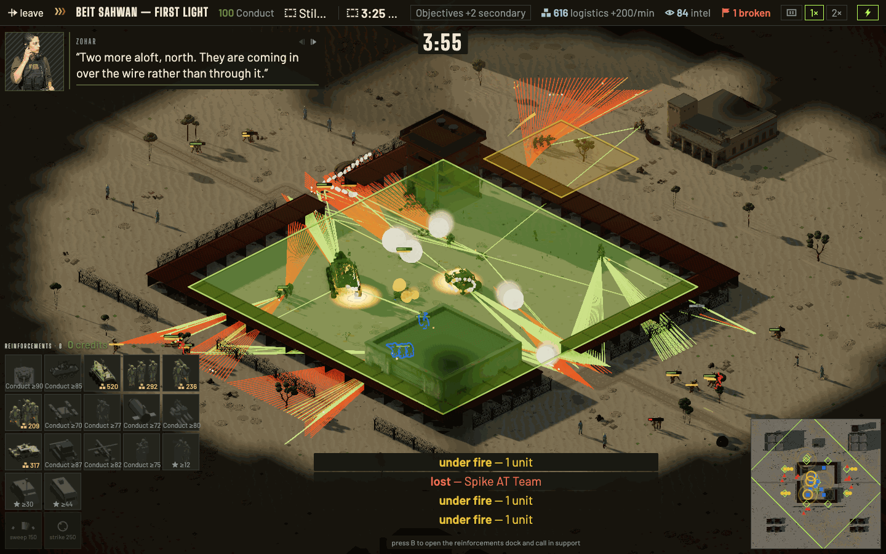
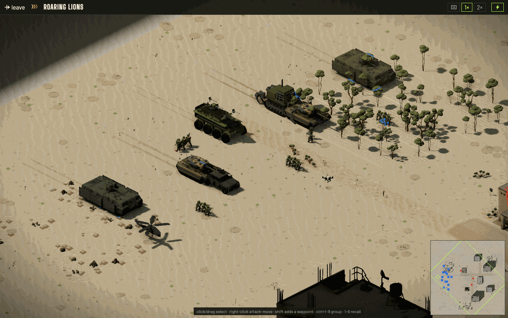

# Roaring Lions

A real-time strategy game in the Command & Conquer tradition, played in your browser. You command the 401st "Ari'im" Brigade of the Kedem Defense Forces (KDF) through a campaign across the fictional Sahar Basin, or take the field against a friend.

Its distinguishing claim is that combat **simulates real engagement odds** instead of trading hit points. A shot has to be seen, has to hit, has to get through the armour, and then damages a component. Cover and suppression decide fights more than raw damage does. Information, initiative and restraint are the scarce things: every mission scores your **Conduct**, and civilian harm, ruined protected buildings and wasteful ordnance cost you.

All geography and factions are fictional. Enemy forces are defined by military doctrine (tunnels and ambush, standoff fires, mobile raiding), never by ethnicity, nationality or faith.



## Play it

**<https://roaring-lions.pint12.workers.dev>**

You need a desktop browser with WebGL2, and a mouse and keyboard. There is nothing to install and no account. That address serves the current `main`. Source and issues: <https://github.com/ilan-pinto/roaring-lions>.

On first launch an opening cinematic plays. Skip it at any time; Settings can replay it.

### The main menu

| Entry | What it is |
|---|---|
| **Start** / **Continue** | Jumps to the next mission of the campaign (the tutorial first). |
| **Campaign** | The campaign map: three fronts, 29 missions. |
| **Brigade** | The garage and the Stores: your units, their upgrades, what unlocks what. |
| **Play with a friend** | Open or join a one-versus-one room. |
| **free play, any map** | Walk any shipped map with a full task force, no mission needed. |
| **replay the tutorial** | *Working Up*, a guided first mission. |
| Saves, Settings, Credits, Feedback | Save slots, options, credits, and the feedback form. |
| **New campaign** | Starts the campaign over. Your brigade (credits, unlocks, upgrades) stays. |

## How to play

The camera looks down at an angle. Select units, give orders, read the ground.

| To do this | Do this |
|---|---|
| Select | Left-drag a box, or click a unit. Click empty ground to clear. |
| Attack-move | Right-click ground. Units engage what they meet on the way. `Shift` queues the order behind the current one. |
| Plain move | Press `n`, then click the ground. |
| Patrol | Press `p`, then click the far end (`Shift`-click adds points). |
| Garrison or demolish | Right-click a building. Troops that can enter it garrison it; Combat Engineers and the D9 raze it. A protected building (a civic hall, say) refuses fire unless you hold `Alt`. |
| Attack one target | Right-click a visible enemy. |
| Formations | With two or more units selected: `r` Column (march in two files), `t` Attack (armour leads, infantry close behind), `y` Ambush (ring the ground and hold). Then click the ground. |
| Control groups | `Ctrl` (`Cmd` on a Mac) + `1`-`9` assigns, `1`-`9` recalls, a second tap centres the camera. |
| Halt | `h` |
| Smoke | `f` lays smoke at the cursor. |
| Load and unload | `g` loads infantry into a carrier, `u` unloads. |
| Idle units, last alert | `i` selects the next idle unit; `Space` jumps to the latest alert. |
| Production dock | `b`. Buy reinforcements with logistics. |
| Fire support | `z` smoke screen, `q` mortar barrage, `c` drone sweep, `v` precision strike. These spend intel. |
| Camera | `W` `A` `S` `D` or the arrows to pan, the wheel to zoom. The minimap takes right-click orders too. |
| Every key | `F1`. `Esc` backs out of whatever is open, and otherwise pauses. |

Two things worth knowing early:

- **Hover a visible enemy with units selected** and the *Projected fire* panel shows each unit's chance to hit, and what is degrading it, before you commit.
- **Cover is the big lever.** A dug-in target is both harder to hit and harder to pin, which is why clearing a held town takes roughly three attackers to one defender. Armour is thin at the rear: keep its nose to the enemy.

Every binding except `Tab`, `Esc`, the control-group digits and the arrow keys can be rebound under Settings, Controls.

## The campaign

You play a KDF officer, Shai Hammai, from a dawn siege to the end of the war, with Idit Zohar, the intelligence officer, supplying the intel. Briefings come in beats on the deploy screen; radio lines and objective labels carry the story during a mission.

| Front | Enemy doctrine | Towns (missions) |
|---|---|---|
| **The Marj Strip** | Ashwar Front: tunnels, IEDs, ambush, human terrain | Beit Sahwan (5), Khan Rafid (3), Deir Amun (3) |
| **Sur** | Sarim Brigades: rockets, anti-tank missiles, standoff | Tel Marum (3), Qarn Hadid (3), Umm Zeitoun (4) |
| **Naharin** | Rif Cells: technicals, raids, mobility; wet ground and rain | Wadi Halam (5), Ein Qasab (3) |

The war opens with *First Light* in Beit Sahwan. Sur opens after Deir Amun III, Naharin after Umm Zeitoun IV, and Ein Qasab after Wadi Halam III. Each mission is meant to take five to seven minutes and has a time limit; running out with a primary objective open is a defeat.

- **Deploy.** Before a mission you pick which veterans fill its slots. Units keep a service record, and veterans aim better and resist suppression.
- **Objectives.** Locate, hold for a time, survive until relief, capture, eliminate a target, evacuate civilians, collapse a tunnel, raze a building, or destroy everything.
- **Conduct and stars.** Every mission scores Conduct from 0 to 100. A win earns one star; a second for Conduct above the mission's floor; a third for completing every secondary objective. The debrief lists each Conduct deduction by reason, your losses by name, and the credit payout.
- **Wounded men.** An infantryman who falls may go down wounded instead of dying. He bleeds out unless a medic reaches him, and nobody fires on him. Most missions loan you a Nemala Medic Team, and rescuing a wounded man, enemy or civilian, earns Conduct.
- **Intel and the ledger.** Recon in one mission can change the next. The ledger carries your named units, Conduct, stars, intel, evacuated civilians and recovered hostages from mission to mission.

## Units



### KDF (the player's brigade)

Your brigade starts with the five units marked *start*. The rest open on **Conduct** (your campaign average, with floors from 70 to 90), on **total stars**, or can be bought with **credits**. Earning is always free; credits only get you there sooner. Most units also have three upgrade tracks, covered under [The brigade](#the-brigade-garage-and-upgrades).

| Unit | Role | What it is for | Opens |
|---|---|---|---|
| Rifle Squad | Infantry | Holds ground and garrisons buildings. Its rifles are the safest thing to fire in a street. | start |
| Chomet Grenadier Squad | Infantry | Grenades reach men behind a wall, never inside a house. Costs Conduct in a flagged street. | credits |
| Spike AT Team | Anti-tank | Kills armour rifles cannot touch, one missile at a time. Place it before you need it. | start |
| Zaron Missile Team | Anti-tank | Kills what your side has spotted, without a sight line, at low collateral. Useless up close. | credits |
| Sniper Team | Marksman | One man at a time, at the least cost a shot can carry. Firing shows the hide. | Conduct 80 |
| 60mm Mortar Team | Artillery | Fires past its own sight, so someone else must look. You are billed for where it lands. | start |
| Te'o Howitzer, Te'o Cluster Howitzer | Artillery | The deepest gun on the map, and bomblets for men in the open. Every round is billed where it lands. | credits |
| Lavi MBT | Tank | Wins any duel it can see out to twelve tiles. Its 120mm is the costliest round for Conduct. | Conduct 90 |
| Lavi Ambush Tank | Tank | Waits under a net and is seen late. A shot gives it away. | credits |
| Namer IFV | Infantry fighting vehicle | Carries five under armour; its 30mm arms the protected-zone penalty. | Conduct 85 |
| Eitan APC | Carrier | Armour that keeps up with the tanks, seats for two, and a gun that answers aircraft. | start |
| Kipod Screen Carrier | Carrier | Six seats behind reactive plate, and a gun that pins people without killing a truck. | 44 stars |
| Shoded Jeep | Light vehicle | Fast and thin. Two seats, a machine gun, nothing that stops a rocket. | start |
| Shachaf Scout Car | Recon | A ground eye that sees sixteen tiles and cannot be shot down. Carries a mast, not a gun. | 30 stars |
| Recon Drone | Drone | Sees sixteen tiles and marks what it finds. No weapon. | Conduct 70 |
| Loitering Munition | Drone | Flies itself at the nearest thing your side has identified, and does not come back. | Conduct 72 |
| Chadaf Recon Robot | Drone | Walks boulders and alleys no wheel can, and finds tunnel routes. Unarmed and cheap to lose. | credits |
| AH-64 Peten, Peten Gunship | Gunship | Crosses the map in seconds and kills armour at standoff. The gunship adds Hellfires and a second pass. | Conduct 82, credits |
| UH-60 Yanshuf | Air transport | Six squads anywhere on the map in a minute. Lose it in the air and you lose them all. | Conduct 84 |
| Remetz Laser Carrier | Anti-air | A laser that burns small drones out of the air, and goes dark behind smoke or a wall. | Conduct 85 |
| Combat Engineers | Engineer | Bring a building down from touching distance without shelling the street. | Conduct 77 |
| D9 Dov | Engineer | Takes a building down with a blade instead of a shell. Unarmed, and cannot be hurried. | Conduct 87 |
| Shiryonan Demolition Carrier | Engineer | Sets a fused charge against a wall and backs off. What stands too close goes with the house. | credits |
| Yahalom Engineers | Engineer | The only team that can collapse a tunnel. | Conduct 75 |
| Tzinah Breach Team | Support | Empties a garrisoned house instead of levelling it. No sustained fire costs Conduct less. | 12 stars |
| Shmamit Deep Recon Team | Support | Keeps a tunnel in sight from boulders or a house, unseen. Once found, it loses the fight. | credits |
| Nemala Medic Team | Support | Treats wounded men under fire and stretchers them out. Barely fights. | credits |
| Pered Armoured Ambulance, Nachlieli Medevac | Support | Carry four wounded out of the fight, by road or by air. Unarmed. | credits |

### The other side: Sarim, Ashwar and Rif

You meet these in the campaign, one doctrine per front. The six in bold are also what the **Sarim** player builds in a [KDF-against-Sarim match](#play-with-a-friend). Free play can add four more Sarim units with its *Sarim roster* option.

| Unit | Doctrine | Role | What it is for |
|---|---|---|---|
| **Sarim Rifles** | Sarim | Infantry | Garrison and screen; the rifle section on each flank. |
| **ATGM Cell** | Sarim | Anti-tank | A Kornet team with 14 tiles of reach, the one Sarim weapon that kills armour through active protection. Sets up hidden. |
| **Recoilless Team** | Sarim | Anti-tank | Short-range anti-armour from cover. |
| **MANPAD Team** | Sarim | Anti-air | Shoulder-fired missiles that threaten helicopters. |
| **Rocket Battery** | Sarim | Artillery | Grad rockets, 20 tiles. Hits ground and structures. |
| **AA Gun Truck** | Rif | Anti-air | Twin autocannon against aircraft, infantry and structures. |
| Loitering Munition, Drone Swarm | Sarim | Drone | One-way strike drones; the swarm is one unit standing for twelve. |
| Militia Cell | Ashwar | Infantry | Garrisons buildings and uses tunnels. |
| RPG Team | Ashwar | Anti-tank | Short reach, hidden setup, tunnels. |
| Mortar Crew | Ashwar | Artillery | 82mm mortar, 16 tiles. |
| Digger Crew | Ashwar | Engineer | Digs the tunnels the Marj Strip is built on. |
| Suicide Squad, Powered Parachute | Ashwar | Raiders | Kamikaze infantry, and paramotor gunmen over the wire. |
| Armed Technical, Armed Motorcycle | Rif | Light vehicle | Fast raiders with a heavy machine gun or an RPG. |

## The brigade: garage and upgrades

Campaign wins pay **credits**: 100 for the win, 40 per carrying secondary objective, 10 per starting-force unit brought home, and 1 per Conduct point over the second-star floor. A replay pays only the improvement, and a defeat pays nothing. The tutorial pays nothing.

Spend credits in the **garage** (Brigade on the menu):

- **Unlock a unit early** that you have not yet earned.
- **Upgrade it.** Most units have three tracks, **armour**, **sensors** and **firepower**, each with up to three tiers. A bought tier applies to every unit of that type: the Rifle Squad's armour tiers cost 115, 175 and 250 credits and add hit points and plate across the whole brigade.
- Turn each model in a close-up and read its specification before buying.

The brigade account survives **New campaign**. The **Stores** tab is a preview of a coin shop and sells nothing today; credits are the only way to buy.

## Free play

Free play (menu, *free play, any map*) puts a full KDF task force on any shipped map against an opposing force, with no mission, and writes nothing to your campaign. It is the place to try a unit, learn a map, or test a tactic. Optional extras:

| Option | Adds |
|---|---|
| Protected ground | No-fire ground that costs Conduct to fire on. |
| Tunnel | A dug tunnel and two Yahalom squads to collapse it. |
| Sarim roster | Four Sarim units the campaign never fields. |
| Civilians | Eight civilians and a refuge to lead them to. |
| Anti-tank ditch | A ditch between the two forces. |
| Kit | Your force already fitted with upgrade level 1 to 3. |
| Field works | Buildable field works and an engineer squad to raise them. |
| Decals | Every ground mark on show: craters, scorch, oil, rubble and tracks. |

## Play with a friend

A one-versus-one match over the internet. Both browsers run the same deterministic simulation and only orders cross the wire. It is for friends: there are no accounts, no matchmaking and no ranking. Nothing from a match is written to your campaign or brigade.

1. The host opens the menu, **Play with a friend**, enters a callsign, and picks a side and a map (below).
2. The host presses **Open a room** and sends the friend the six-character code, or **Copy link**.
3. The friend opens the link (or types the code under *Join a match*), enters a callsign, and joins.
4. Both press **Ready**. The match starts for both.

Both of you need the same version of the game: reload the page if the room reports a mismatch.

**Choose your side.**

| Side | What you get |
|---|---|
| **Mirror** | KDF against KDF. Both of you field the same placed force of tanks, IFVs, infantry, a gunship and a recon drone. No economy. |
| **KDF** | You command the KDF; your friend takes the Sarim. |
| **Sarim** | You command the Sarim: anti-tank teams by the dozen, gun trucks and Grad rockets. |

**Choose the ground.** Every map below was measured close to even for both starts in simulated matches.

| Map | Size | Pairings |
|---|---|---|
| Tel Marum, The Gateway | 48 x 48 | Mirror, KDF against Sarim |
| Wadi Tarfan, The Three Fords | 48 x 48 | Mirror, KDF against Sarim |
| Wadi Tarfan (large) | 96 x 96 | Mirror, KDF against Sarim |
| Beit Sahwan, Outskirts | 48 x 48 | Mirror only |
| Milh Flats, Bir Milh | 48 x 48 | Mirror only |
| Milh Flats (large) | 96 x 96 | Mirror only |
| Rujm Sawda, The Black Cairn | 80 x 80 | Mirror only |

**What a KDF-against-Sarim match plays like.** Each side starts with a placed force and a camp. The camp is a production line: buy units from your side's menu, and hold **income zones** on the map (ground you hold alone pays on top; an enemy inside pays nobody). A camp under attack stops delivering.

- The KDF menu: Lavi, Namer, Eitan, Spike team, Rifle Squad, mortar team, Shoded jeep, recon drone, D9, Peten and Yahalom engineers.
- The Sarim menu: Sarim Rifles, ATGM cell, AA gun truck, MANPAD team, rocket battery and recoilless team.
- The Sarim go **underground**. Each end has tunnel routes: Sarim foot units can enter one, travel unseen, and come up at the far vent. The KDF answer is a recon drone to find a route and Yahalom engineers to collapse it.

**Rules of the room.**

- Each of you sees only what your own side sees. Enemy fire from fog draws no tracer, and a hidden enemy cannot be selected.
- `Esc` pauses: three pauses each, 90 seconds each, and only the player who paused can resume early. `Enter` opens chat.
- If a window reloads or drops, it rejoins by itself and catches up; the other shows "Waiting for ..." until it does.
- A match ends when a force has no armed unit left, when someone surrenders or leaves, or at the time cap: 25 minutes, 35 on Rujm Sawda and the two 96 x 96 maps. At the cap the larger surviving force wins.
- **Bring your brigade** is a host toggle, for friends only: each of you fields the upgrades you have bought. The default is the same standard kit for both.
- Formations (`r` `t` `y`) work in a room on the 48 x 48 maps; they are off on Rujm Sawda and the two large maps.
- If the two simulations ever disagree, the match is halted and marked void, never silently patched up.

**An advisor beside you.** In the lobby, under *Invite an advisor*, you can seat an AI model as your adviser. It sees only what your side sees. In **Advise** mode it talks to you and pings the map. In **Assist** mode it also proposes orders: each shows on your screen for two seconds, in plain words, and becomes your own order unless you veto it (`X`, or the Veto button). Your friend is told you have one. Setting one up needs a checkout of this repository and an MCP-capable client: see [`docs/net/N4-agent.md`](docs/net/N4-agent.md), section 1.

## Play against a bot

The browser has no computer opponent for a versus room. Instead an AI model can take the second seat of a room exactly as a friend would, through the same orders a human sends. It needs a checkout of this repository (Node 22 and pnpm), the [Claude Code](https://claude.com/claude-code) CLI signed in, and a model you can pay for.

1. In the browser, open a room as above (**Play with a friend**, pick a map, **Open a room**) and note the code.
2. From a checkout at the same commit as the live game (the foot of Settings reads `Build <version>+<commit>`):

```bash
pnpm install
pnpm bot -- --room ABC123 --model sonnet
```

`--model` takes `sonnet`, `opus`, `haiku` or a full model id; `--callsign`, `--server` and `--client` are optional. The bot joins the room, plays the second seat, and prints the result and its token use. Each run leaves a log and a short report (what happened, and any bugs it noticed) in `bot-results/`. Its orders are throttled to about one batch a second, which is what a human clicking once a second costs. Run it from an ordinary terminal, not from inside another Claude app. Full details: [`docs/net/N4-agent.md`](docs/net/N4-agent.md), section 2.

## AI against AI

`pnpm arena` plays one player against another over a set of seeds on your own machine and scores them. It runs a local relay, with no network and no account. The built-in players are `passive` and `rush`, two simple scripted controls, and a model can be plugged in as `cmd:<command>`:

```bash
pnpm arena -- --a rush --b passive --seeds 10 --map tel_marum --pace 60
```

Every seed is played twice with the seats swapped, and results go to `arena-results/`. A screen in the game for **watching** AI matches is planned (GH-954) and is **coming**; it is not in the build yet. See [`docs/net/N4-agent.md`](docs/net/N4-agent.md), section 3.

## Settings and accessibility

Open Settings from the menu, or from the pause menu (`Esc`) in a mission.

| Setting | Options |
|---|---|
| **Colour vision** | Default, deuteranopia, protanopia, tritanopia. Team colours change at once on the map, the minimap and the HUD. |
| **Interface scale** | Automatic by screen width, or a fixed percentage. |
| **Text size** | Normal or a larger percentage. |
| **Motion** | Follow the system setting, or reduce motion. |
| **Voice captions** | English text for what a unit's radio line means, above the orders. |
| **Controls** | Rebind keys; camera speed, edge pan, zoom to cursor. |
| **Audio** | Master, music, effects, voices, and the radio effect. `m` mutes in a mission. |
| **Render quality** | High, medium or low. Applies when the next mission starts. |
| **Fullscreen**, **Replay intro** | As named. |
| **Language** | English only today. The interface is built for more. Unit voices are Hebrew for the KDF and Arabic for the enemy, and only some lines are recorded so far. |

Save slots (menu, *Saves*) snapshot your campaign and brigade.

## Feedback and privacy

The **Feedback** link on the menu, and a tab in the pause menu, send a note with the game version, graphics card, screen size and mission state. You choose whether to attach a screenshot, a replay (bugs only) and contact details. A note can be a bug, balance, confusing, an idea or praise.

The live build sends play telemetry (session, mission, campaign and brigade events) to its own server under a random id kept in your browser. It keeps no e-mail, IP address or URL. Adding `?notrack` to any address opts out and remembers the choice; Global Privacy Control and Do Not Track are honoured.

## For contributors

Read [`CONTRIBUTING.md`](CONTRIBUTING.md) and [`CLAUDE.md`](CLAUDE.md) first, and [`docs/GDD.md`](docs/GDD.md) for what the game is. The programme ledger is [`docs/HANDOVER.md`](docs/HANDOVER.md).

Requirements: Node 22 and pnpm 11.17.0. The audio gate needs Python 3 with `numpy`, the mesh gate needs `numpy`, `pillow` and Blender 5.2, and the visual tools need Playwright Chromium.

```bash
pnpm install
pnpm dev                # Vite on http://localhost:5173; /free-play/<map id> walks a map
pnpm test               # unit tests
pnpm test:determinism   # 1000-tick replay against the pinned state hash
pnpm typecheck
pnpm lint
pnpm validate:data      # JSON Schema gate on every content file
pnpm validate:ui        # no colour literals, no bare chrome strings
pnpm validate:meshes    # the art gate (needs Blender)
pnpm validate:audio
pnpm balance            # headless battle simulation against the combat targets
pnpm playtest           # a scripted plan must win every campaign mission
pnpm build              # production build, what the Cloudflare Worker serves
```

The code is a pnpm workspace with one-way dependencies, `app` to `render` to `sim`, with `data` a leaf. The simulation (`@lions/sim`) runs a fixed 20 Hz tick in Q16.16 fixed point with seeded per-entity randomness, commands in and state and events out; that is what makes replays, the visual gate and multiplayer possible. Content (units, missions, maps, VFX) is JSON validated against `data/schemas/`. The renderer is three.js behind one interface, and `packages/net` and `packages/worker` carry the lockstep relay and the telemetry.

Code is source-available under the PolyForm Noncommercial License 1.0.0 ([`LICENSE`](LICENSE)); art and game data are all rights reserved ([`data/LICENSE.md`](data/LICENSE.md)). Contributions are accepted under [`CLA.md`](CLA.md) with a DCO sign-off (`git commit -s`). AI-generated art is permitted if the pull request discloses it.

More: [`docs/ART_PIPELINE.md`](docs/ART_PIPELINE.md), [`docs/PERFORMANCE.md`](docs/PERFORMANCE.md), [`docs/campaign/storyline.md`](docs/campaign/storyline.md), [`docs/net/N4-agent.md`](docs/net/N4-agent.md).
