# Cinematics storyboard

The lead approved this route on 2026-10-11, from
[the generative-video report](../research/2026-10-11-generative-video.md) (PR #528).
The tool is the paid Gemini API: Gemini Omni Flash for most takes, and Veo 3.1
where a shot needs a pinned first and last frame (a loop) or a 1080p master.
The scope is a 24 s intro, one briefing backdrop for each of the seven towns,
and replacements for the two Tel Marum briefing videos that shipped with no
provenance. Every shot starts from one of the game's own renders and has
nobody in it. The hard cap is **$150**.

**Nothing has been generated and nothing has been spent.** This page and
[`shots.json`](shots.json) are the plan. Production waits on the lead's
billing setup and a go ([README](README.md#setting-up-billing-and-the-key)).

## The total

| | Shots | Explore (Omni Flash, 720p) | Final | Subtotal |
|---|---|---|---|---|
| Intro | 3 | 4 takes each, $4.07 a shot | Veo 3.1 Standard, 1080p, 8 s, 2 takes each: $6.40 a shot | **$31.40** |
| Town backdrops | 7 | 4 takes each, $4.07 a shot | Veo 3.1 Fast, 720p, 8 s, pinned loop, 2 takes each: $1.60 a shot | **$39.72** |
| Tel Marum replacements | 2 | 4 takes each, $4.07 a shot | Veo 3.1 Fast, 720p, 8 s, pinned loop, 2 takes each: $1.60 a shot | **$11.35** |
| **Total** | **12** | **$48.87** | **$33.60** | **$82.47** |

That leaves **$67.53 under the $150 cap** for retakes. This total is what
`pnpm video -- estimate` prints from `shots.json`. The prices were quoted from
the Gemini API pricing page on 2026-10-11. `tools/src/video/storyboard.test.ts`
fails if the plan ever leaves the report's $45 to $115 band, or comes within
$30 of the cap.

How the estimate is built, and why it errs high:

- **Omni Flash** is billed by output tokens: 5,792 tokens a second of 720p, at
  $17.50 per 1M, which is about $0.10 a second. Its request has no duration
  field, and a clip runs 3 to 10 s. So **every Omni take is priced at the full
  10 s**, which comes to $1.02 with the input images included.
- **Veo** is billed per second of output. Veo 3.1 Standard is $0.40 a second
  at both 720p and 1080p. Veo 3.1 Fast is $0.10 a second at 720p. Google
  charges only for a take that succeeds, but the ledger counts every take that
  is sent.
- The finals are capped at the length of the slot. The deploy screen shows the
  video about 260 px tall, so 720p from Veo 3.1 Fast is plenty there. Standard
  at 1080p is spent only on the intro, which also has to serve as a trailer
  master.

## The rules every shot follows

Every prompt sent is the shot's motion line, wrapped in two fixed parts:

1. **Before the motion line (the style lead-in):** "Animate this still from a
   stylised real-time strategy game. Keep the high three-quarter overhead
   camera angle, the game's art style, every building and the layout of the
   ground exactly as in the image; nothing new enters the frame." Loop shots
   add: "The motion is gentle and cyclic so the final frame returns to the
   first."
2. **After the motion line (the content rules, `CONTENT_RULES_SUFFIX` in
   `tools/src/video/request.ts`):** no people, faces, figures, soldiers or
   animals; no vehicles moving; no text, captions, numbers, flags, insignia,
   emblems, logos or religious symbols; no fire, explosions or gunfire; no
   dialogue or music.

These rules come from the report's sections 3.1 and 3.4. Google's filters
silently drop violence and recognisable people. The project's setting rule
keeps the war fictional (Kedem, the Sahar Basin) and allows no real flag,
uniform or insignia. A frame with nobody in it is also the case Veo's
people rules never touch. The prompts ask for terrain, light and weather, and
never for combat.

**The stills are built people-free.** `pnpm stills:cinematics`
(`tools/src/perf/cinematic-stills.ts`) photographs each still through the real
game. It used one Metal browser, with music off, on its own port (5197). It
hides every unit body (the `units` layer), every overlay, the fog, any round
in flight, the FX and smoke bands, and every piece of HUD before it takes the
picture. What is left is ground, buildings, decor and props: the game's own
Meshy-textured buildings under its own dimetric light. Each still is a
1280x720 JPEG of 120 to 210 KiB.

**Review every take before it is kept.** The checklist:

- No face, figure or animal, even in the distance.
- No flag, insignia, emblem, lettering or number.
- The buildings, roads and ridges are the still's. Nothing new has been
  invented.
- No fire, muzzle flash or explosion.
- In a loop, the last frame matches the first.
- The audio has been looked at. It is stripped when the file is encoded
  anyway.

## Intro, 24 s (3 shots x 8 s, cut together)

Ships as `assets/video/intro.mp4` once something in the game plays it (see
the README's "Delivery"). The 1080p finals are also the trailer master. Each
shot is unpinned (`loop: false`).

| | Still | Source | Motion line | Plan, cost |
|---|---|---|---|---|
| **intro_1_wall**: dawn on the wall | 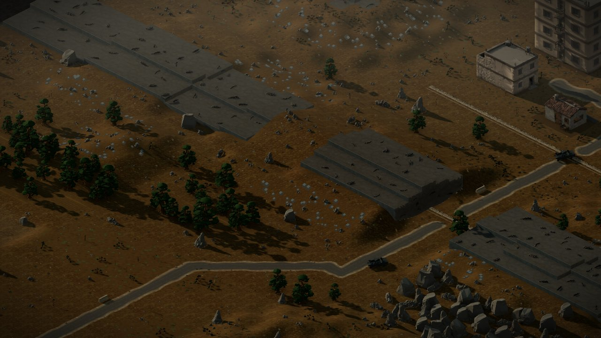 | `qarn_hadid`, dawn, camera (21, 22), zoom 0.9 | A very slow push-in toward the gap in the rock wall where the road passes through. Low dawn light rises across the plain, long shadows shorten a little, a thin ground haze drifts left to right and thins as the light grows. | 8 s; explore 4x Omni 720p, final 2x Veo 3.1 1080p; **$10.47** |
| **intro_2_groves**: the valley wakes | 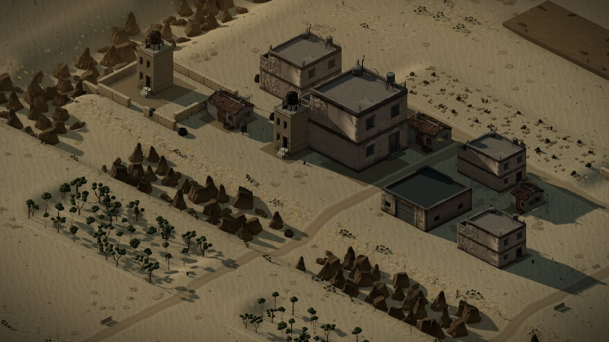 | `deir_amun`, dawn, (24, 26), zoom 1.0 | A slow lateral drift to the right over the groves and rooftops. Wind moves through the trees in waves, dust lifts off a dirt track and settles, high cloud shadows slide across the fields. | as above; **$10.47** |
| **intro_3_town**: the town waits | 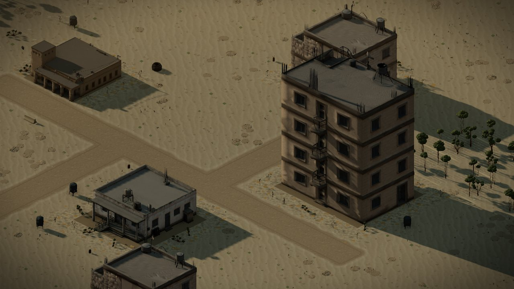 | `beit_sahwan_outskirts` (the menu's own map), dawn, (31, 18), zoom 1.3 | A slow pull-back and rise over the town. Morning haze burns off the streets, laundry on a rooftop line stirs in the breeze, a rooftop water tank catches the light, the light warms from grey to gold as the sun rises. | as above; **$10.47** |

The edit: the three finals joined with 0.5 s crossfades, giving about 23 s.
The last shot is the menu's own map at dawn, so the cut can hand straight
over to the live scene host. Titles are added in the edit and never asked of
the model.

## Town backdrops (7 x 8 s, pinned loops)

Each backdrop plays on the town's **first** mission, through the existing
`briefing_video` field. The same still is sent as both the first and the last
frame (Omni's two-image interpolation while exploring, then Veo's
`image` + `lastFrame` for the final). The clip therefore returns to where it
started, and can loop if the deploy screen ever loops it. Today it plays
once; see the README.

| Town | Still | Source | Motion line | Ships as | Cost |
|---|---|---|---|---|---|
| **Beit Sahwan** | 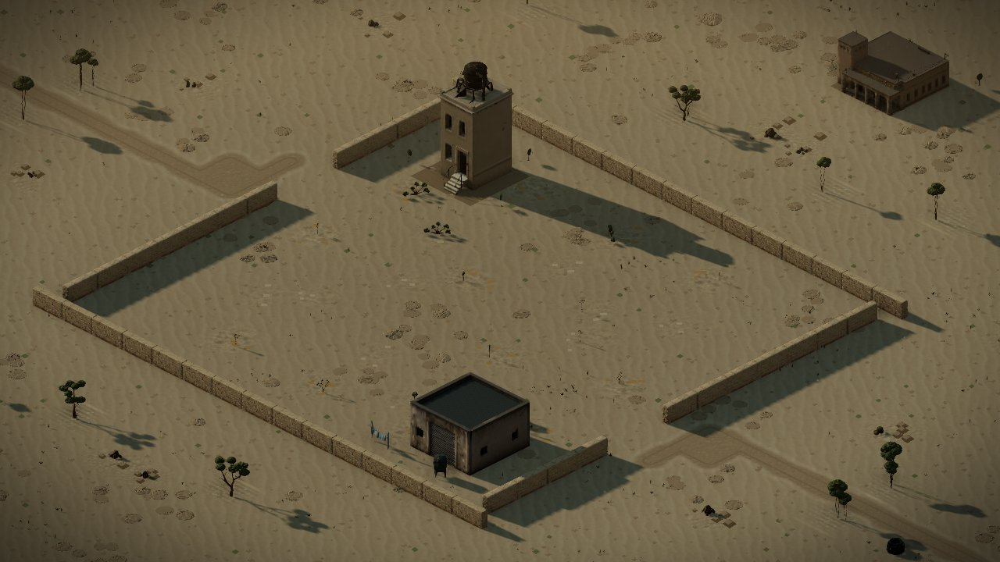 | `marj_perimeter` (the map `beit_sahwan_breach` plays), dawn, (24, 22), zoom 1.2 | A barely perceptible push-in toward the walled compound and its watchtower. Dust blows along the outer wall in the morning wind, long dawn shadows creep slowly across the open sand. | `video/beit_sahwan_briefing.mp4` on `beit_sahwan_breach` | $5.67 |
| **Khan Rafid** | 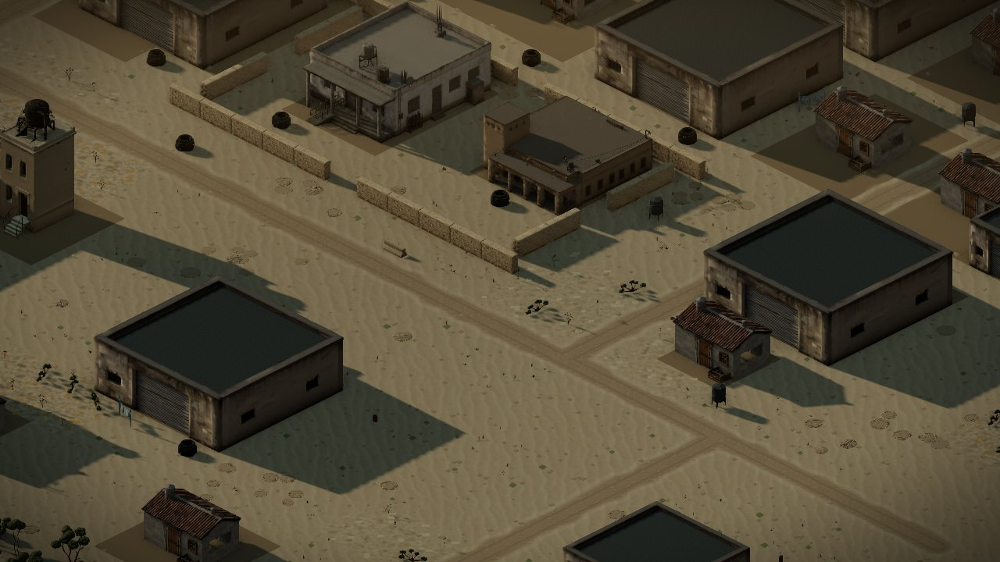 | `khan_rafid`, dawn, (30, 24), zoom 1.25 | A slow drift along the main street over the flat roofs of the market quarter. Laundry lines on the roofs stir, fine dust hangs in the low sun between the buildings, a light breeze moves the few trees. | `video/khan_rafid_briefing.mp4` on `khan_rafid_1_recon` | $5.67 |
| **Deir Amun** | 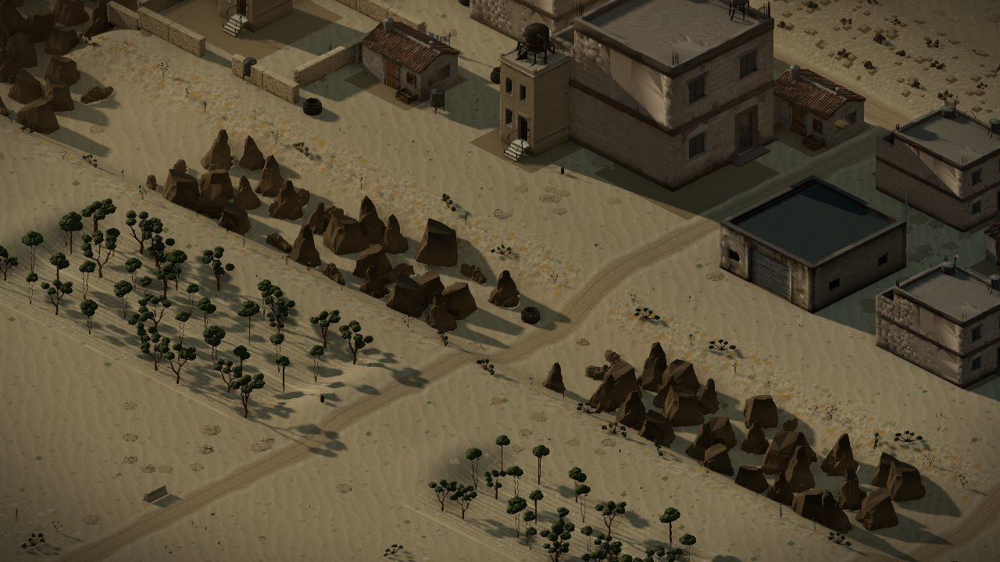 | `deir_amun`, dawn, (26, 30), zoom 1.25 | A slow push-in over the crossing where the track meets the dry wadi bed. Grove trees sway in the breeze, thin mist lies in the low ground and slowly breathes, a little dust drifts along the bed. | `video/deir_amun_briefing.mp4` on `deir_amun_1_recon` | $5.67 |
| **Tel Marum** | 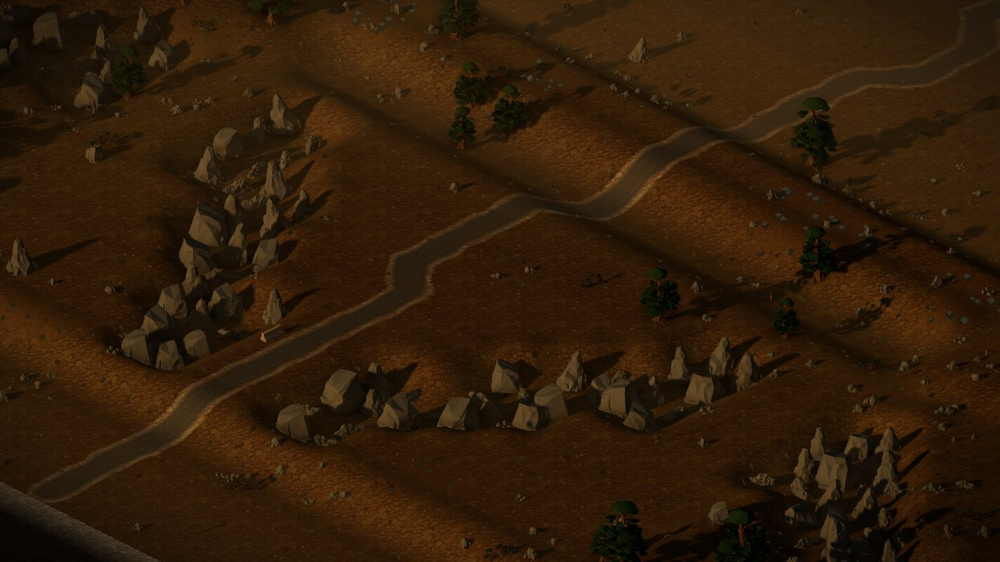 | `tel_marum_1`, dusk, (25, 33), zoom 1.2 | A slow drift toward the rocky high ground in fading dusk light. Warm last light slides off the ridges, cool shadow pools in the hollows, dust drifts over the road and settles. | `video/tel_marum_briefing.mp4` on `tel_marum_1_recon` | $5.67 |
| **Qarn Hadid** | 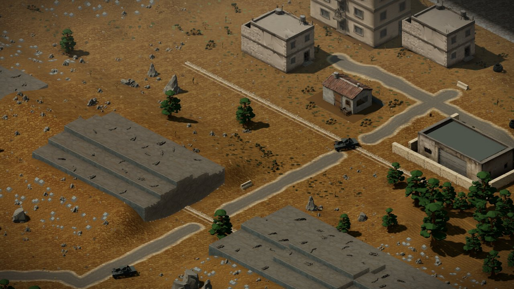 | `qarn_hadid`, day, (27, 14), zoom 1.25 | A slow lateral drift over the village square and its lanes. Heat shimmer rises off the open ground, cloud shadows pass over the rooftops, a breeze turns a few leaves in the yards. | `video/qarn_hadid_briefing.mp4` on `qarn_hadid_1_recon` | $5.67 |
| **Umm Zeitoun** | 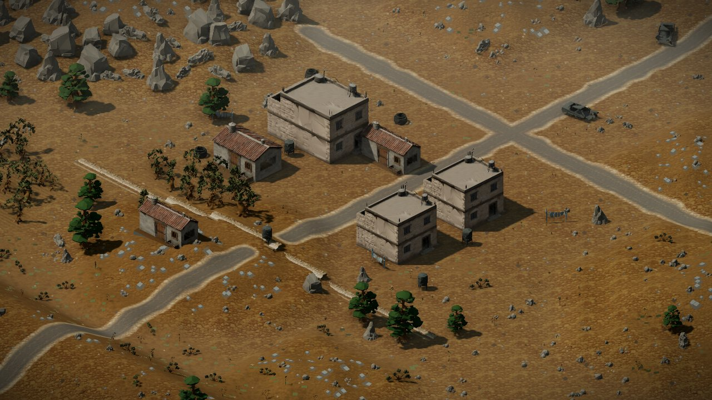 | `umm_zeitoun`, day, (24, 27), zoom 1.25 | A barely perceptible push-in over the hamlet square. Cold clear air, olive trees moving in a steady wind, dust curling off the rim and down the slope, cloud shadows crossing the bowl. | `video/umm_zeitoun_briefing.mp4` on `umm_zeitoun_1_recon` | $5.67 |
| **Wadi Halam** | 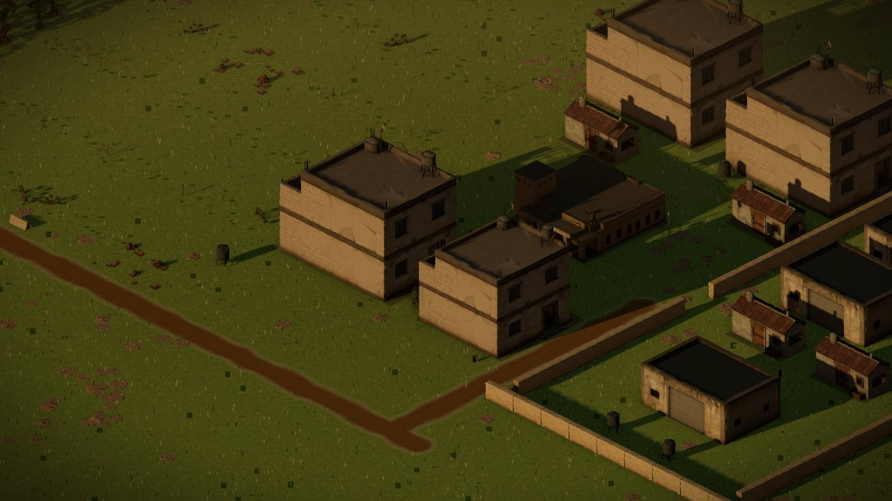 | `wadi_halam_basin`, dusk, (28, 27), zoom 1.25 | A slow drift over the green fields toward the walled village. Grass ripples in the evening wind, long warm shadows stretch from the houses, the light deepens slowly toward dusk. | `video/wadi_halam_briefing.mp4` on `wadi_halam_1_fords` | $5.67 |

Each shot is planned as 4 Omni explore takes plus 2 Veo 3.1 Fast finals at
720p, 8 s each.

## The two Tel Marum replacements

The two shipped files (`assets/video/tel_marum_{2,3}_briefing.mp4`) are
photoreal people: a commander briefing soldiers over a map, and a helmeted
commander speaking in desert hills. Each carries a speaking AAC track, and
there are plate-carrier emblems in shot. Nothing records how they were made
(ASSET_PROVENANCE.md item 4; `data/video.json` now says so per file). Under
the approved route they are replaced by **people-free** backdrops of the same
two missions' ground. The spoken line goes with them. The briefing beats
already carry the same orders as text, and nothing else on the deploy screen
changes.

| Mission | Still | Source | Motion line | Replaces | Cost |
|---|---|---|---|---|---|
| **Tel Marum II, The Start Line** | 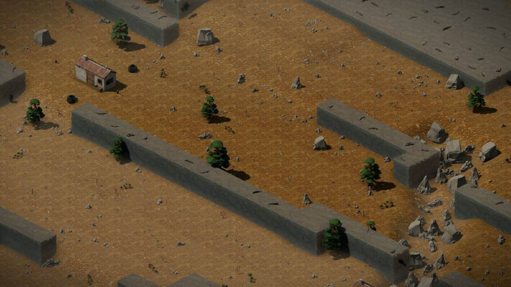 | `tel_marum_2`, day, (21, 27), zoom 1.2 | A slow push-in toward the breach in the long rock ridge where the boulders lie. Midday heat shimmer, dust lifting off the scree in gusts and settling, cloud shadows sliding across the plateau. | `video/tel_marum_2_briefing.mp4`, same path, so `tel_marum_2_foothold.json` is unchanged | $5.67 |
| **Tel Marum III, The Pass** | 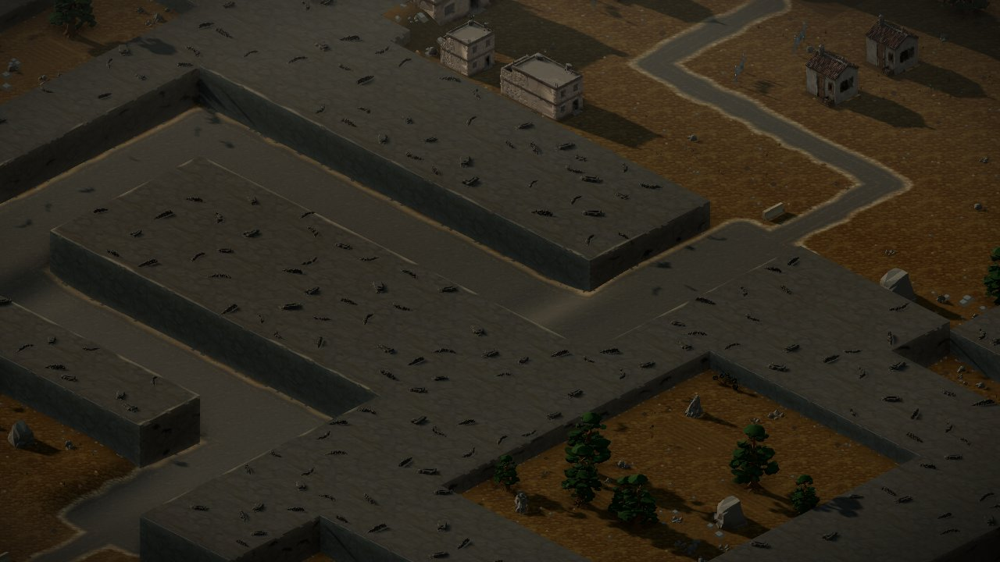 | `tel_marum_3`, dawn, (29, 18), zoom 1.2 | A slow drift toward the pass between the grey rock shelves. Pale dawn light spreads across the stone, mist lifts out of the pass and thins, a little loose gravel trickles down a slope. | `video/tel_marum_3_briefing.mp4`, same path | $5.67 |

**The other choice for the lead:** if the lead can establish how the
originals were made (tool, plan, date, and the source of the audio), they can
stay instead, with their `data/video.json` entries filled in (report,
decision 3). That saves $11.35. But a photoreal soldier with a real-looking
emblem on his vest is outside the approved people-free scope, so this page
plans the replacement.

## Known limits of the stills

- Three stills show a sliver of the map's edge in one corner: `tel_marum`
  (bottom left), `qarn_hadid` and `regen_tel_marum_3` (top right). The
  dimetric camera cannot frame a 48-tile map's interior any tighter at these
  zooms without losing the subject. Watch that corner in review. A take that
  "fills in" the void with invented ground fails the checklist.
- The game's camera never sees a sky, so no prompt asks for one. "Dusk" and
  "dawn" are the game's own light presets (`&tod=`).
- `beit_sahwan_outskirts` draws a stray streak over one rooftop near (25, 24).
  No draw layer and no FX band hid it, so `intro_3_town` is framed clear of
  it. It may be worth a look as a renderer bug; it is not a cinematics
  problem.

## Re-shooting a still

Edit the shot's `capture` block in `shots.json` (map, light, camera tile,
zoom), then run:

    pnpm stills:cinematics -- --only=<id>

The run takes about 10 s a shot, uses one browser, and touches nothing but
the named still. `storyboard.test.ts` then checks the still is on disk at
1280x720.
