# GH-85: the unused effect triggers, before and after

`pnpm blast:capture -- --label=before|after --only=<id>` (`tools/src/perf/blast-captures.ts`, the six GH-85 subjects).
Before is `origin/main` at 87d213e6 with this branch's harness copied in; after is this branch. Both: macOS arm64, ANGLE/Metal,
1400x900 at deviceScaleFactor 1, frozen frame loop, `beit_sahwan_outskirts` sandbox, one isolated page per subject, music off.
Ladder crops are 600x400 JPEG q82 of the PNG the harness wrote; establishing shots are downscaled to 700 px. Full conditions in
`before/sheet.md` and `after/sheet.md`.

## `ricochet_d9`

`armor_ricochet` (`impact_armor`): 12.7 mm off a D9. Before: nothing at the hull, ever.

| rung | before | after |
|---|---|---|
| 00000ms |  | 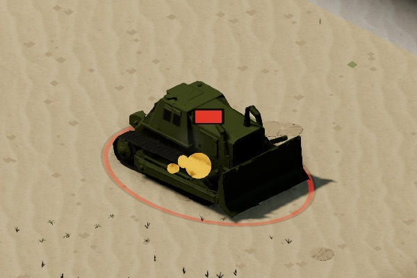 |
| 00050ms |  | 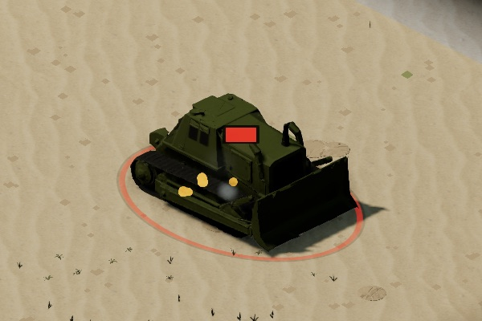 |
| 00100ms |  |  |
| 00200ms |  |  |
| 00400ms |  | 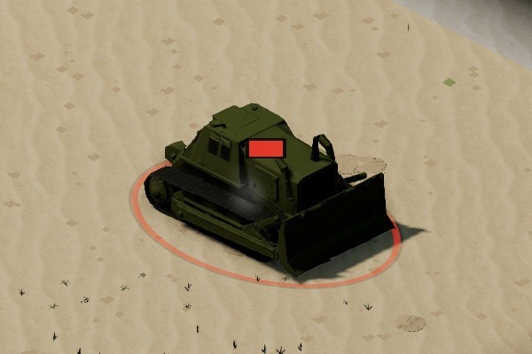 |
| 00800ms |  | 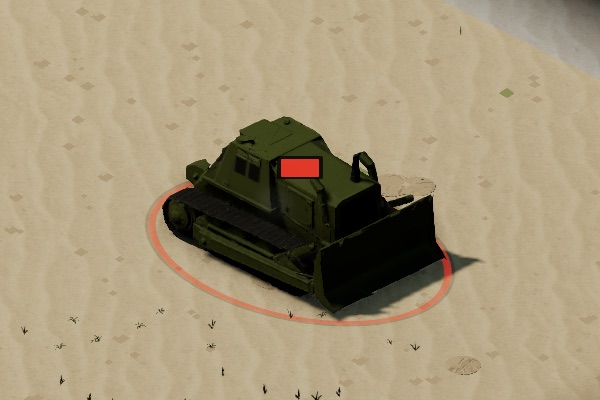 |

## `penetration_d9`

`armor_penetration` (`penetration`): 30 mm into a D9's rear. Before: a flat flash on the TICK, ~176 ms before the round visibly arrived, gone by rung 0.

| rung | before | after |
|---|---|---|
| 00000ms |  |  |
| 00050ms |  |  |
| 00100ms |  |  |
| 00200ms |  |  |
| 00400ms |  |  |
| 00800ms |  |  |

## `aps_lavi`

`aps_launch` (`interceptor_launch`): the Lavi's APS firing at an inbound Kornet, toward the shooter (right). The fireball is the existing `missile_impact`.

| rung | before | after |
|---|---|---|
| 00000ms |  | 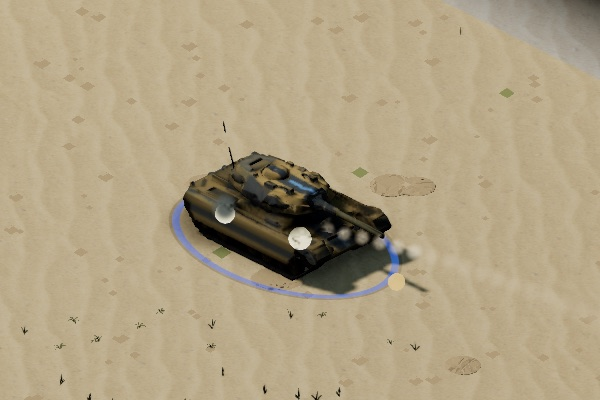 |
| 00050ms | 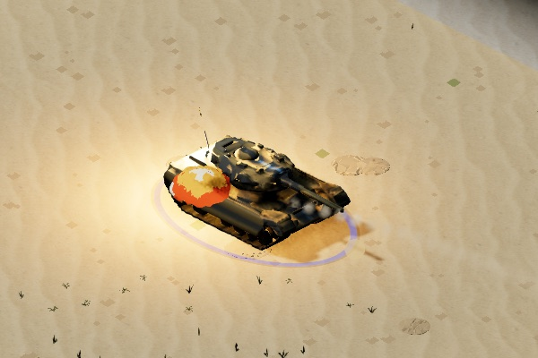 | 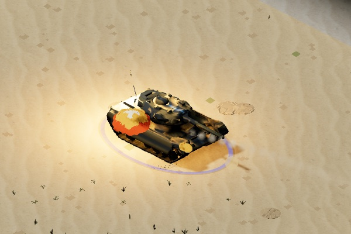 |
| 00100ms | 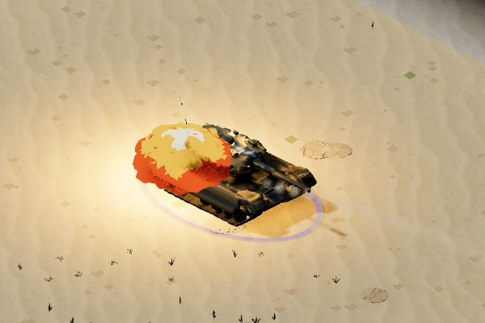 | 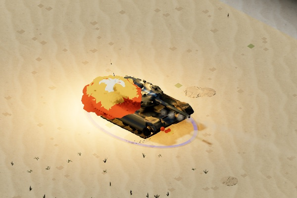 |
| 00200ms |  | 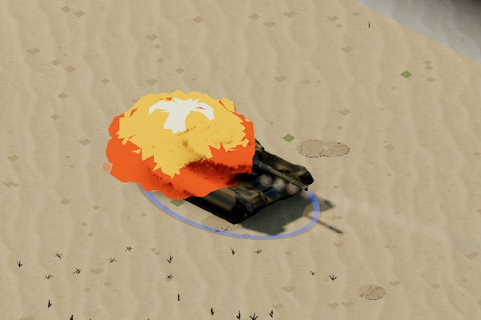 |
| 00400ms | 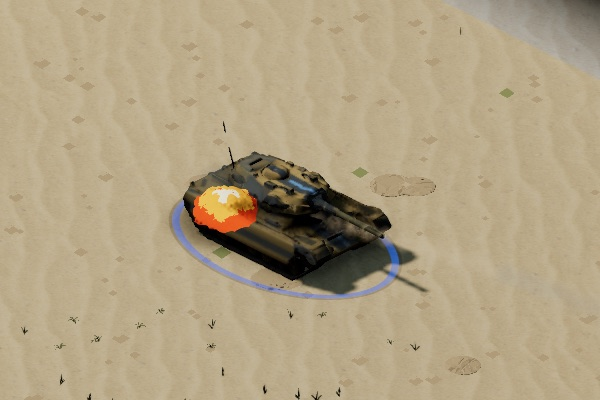 | 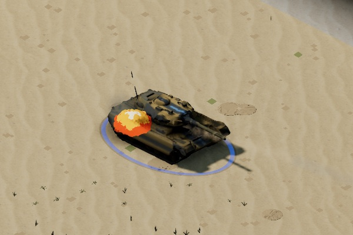 |
| 00800ms | 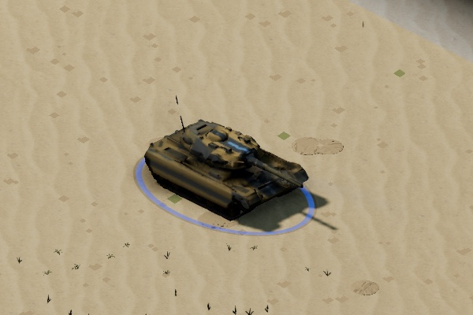 |  |

## `smoke_eitan`

`smoke_discharge` (`smoke_screen`): the pop at the Eitan that laid the screen. The screen itself is unchanged.

| rung | before | after |
|---|---|---|
| 00000ms | 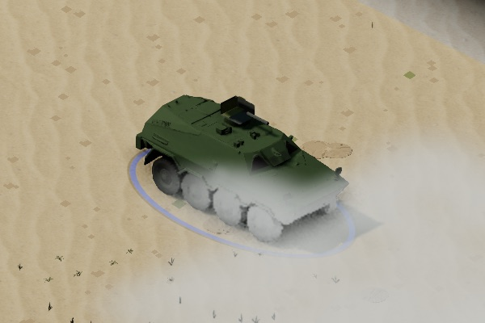 |  |
| 00100ms |  |  |
| 00250ms | 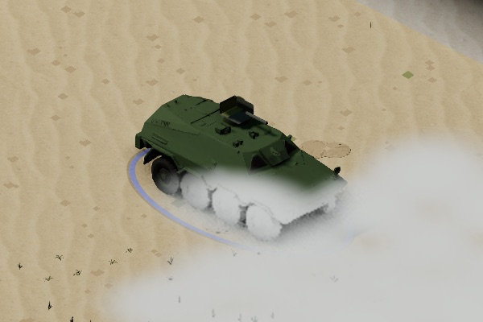 | 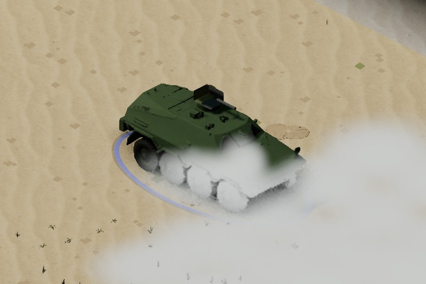 |
| 00500ms | 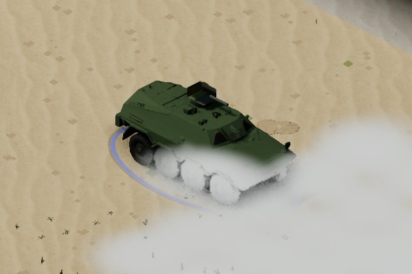 | 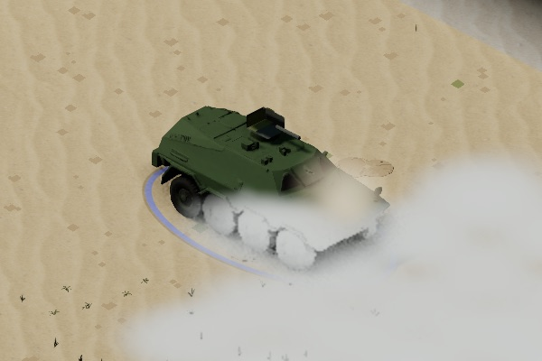 |
| 01000ms | 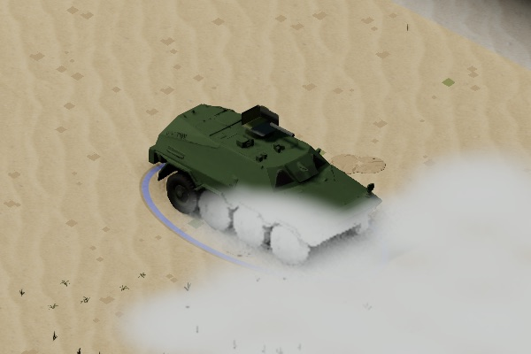 |  |

## `charge_demo`

`demolition_blast` (`eod_breach`): a demo squad's satchel going off. Before: the flat dust puff of a rifle miss when a charge misses, nothing when it hits. (This throw missed; the sim's `nearMiss` put it a tile west.)

| rung | before | after |
|---|---|---|
| 00000ms | 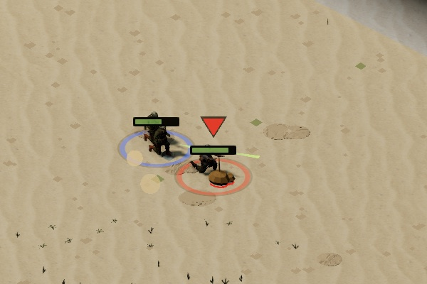 | 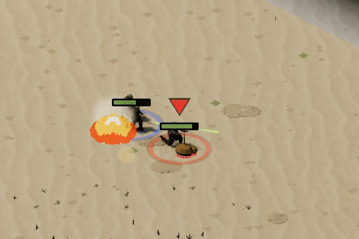 |
| 00100ms |  | 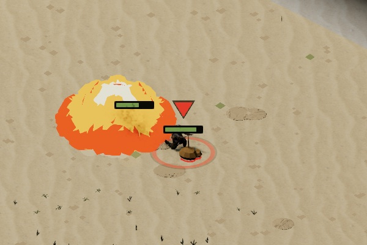 |
| 00200ms |  | 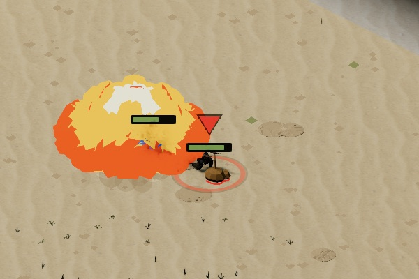 |
| 00400ms | 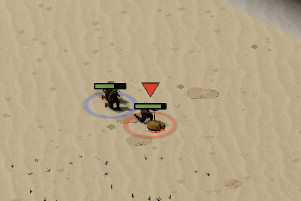 | 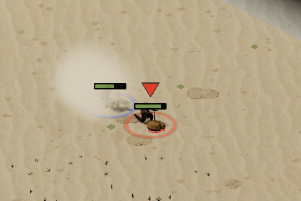 |
| 00800ms |  | 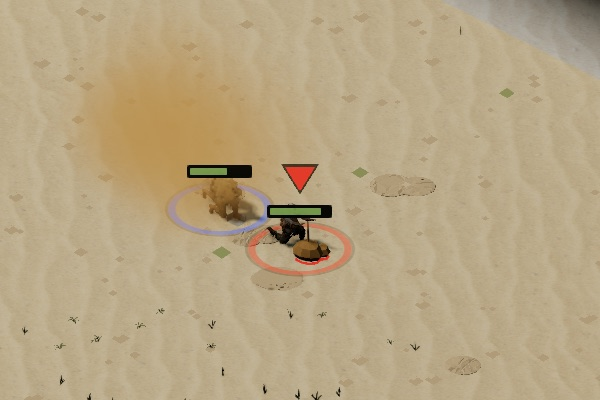 |
| 01600ms |  |  |

## `smoulder_lavi`

`wreck_smoulder` (`catastrophic_kill`): the hull smoking on after the 20 s column, sim-dated, out at 60 s.

| rung | before | after |
|---|---|---|
| 00000ms |  | 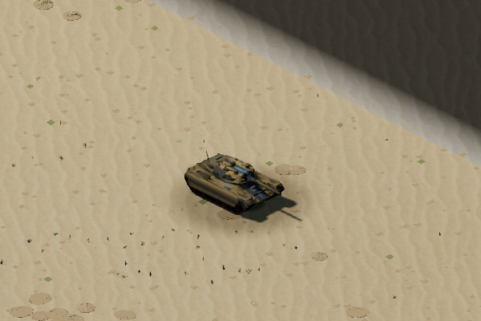 |
| 02000ms | 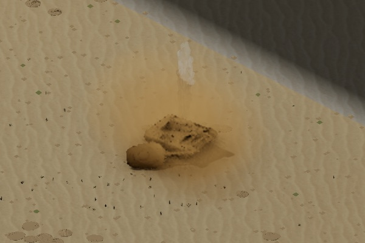 | 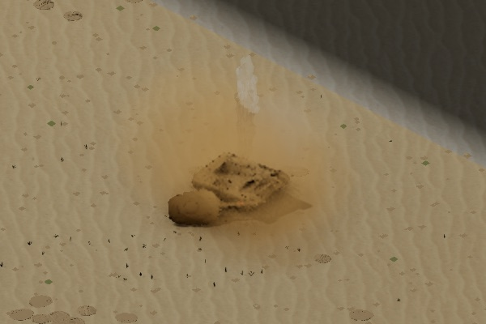 |
| 10000ms | 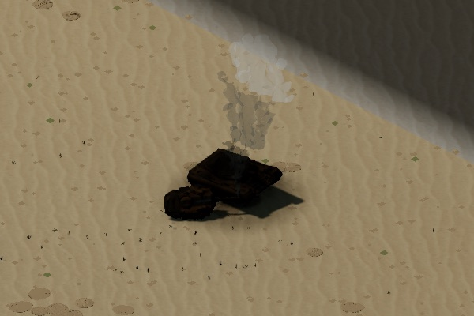 | 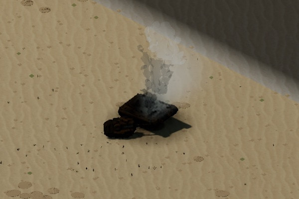 |
| 20000ms | 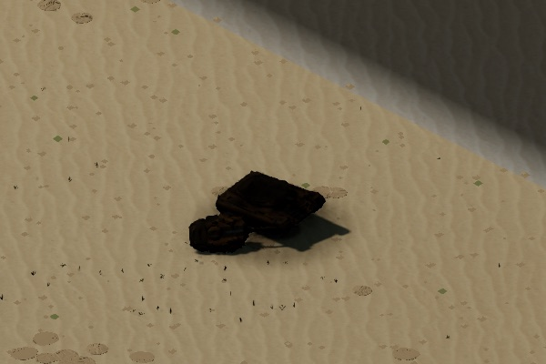 | 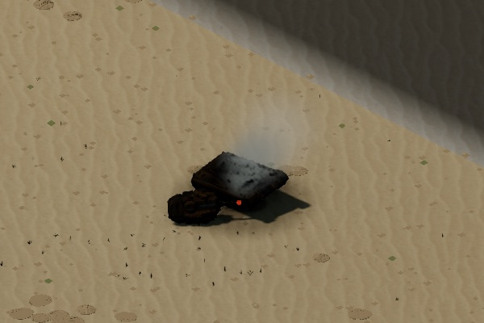 |
| 30000ms |  |  |
| 45000ms |  | 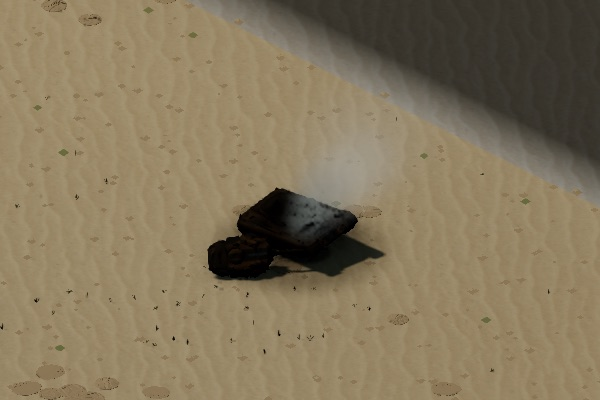 |
| 59000ms |  | 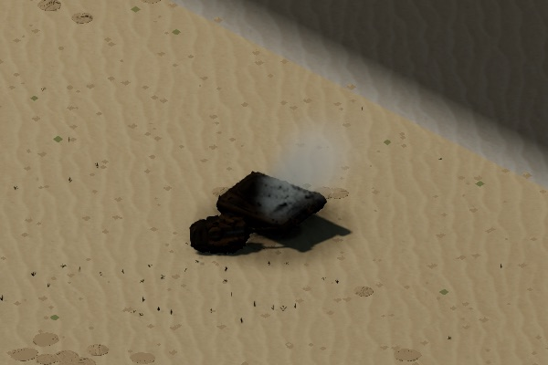 |
| 64000ms |  |  |
